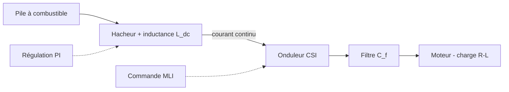

# Onduleur source de courant (CSI) 300 kW alimenté par pile à combustible

## Description

Projet personnel de modélisation d'une chaîne de propulsion électrique de 300 kW sous MATLAB/Simulink.

Une pile à combustible fournit l'énergie. Un hacheur la transforme en un courant continu constant, puis un onduleur source de courant (CSI) découpe ce courant pour alimenter un moteur en courants sinusoïdaux à 400 Hz, la fréquence des réseaux électriques embarqués en aéronautique.

Le modèle couvre le dimensionnement des composants passifs, la commande des deux convertisseurs et la vérification en simulation : qualité des courants, fonctionnement à pleine puissance et stabilité lors d'une variation brusque de la charge.

## Chaîne modélisée

## Contenu du dépôt

| Fichier | Rôle |
|---|---|
| `scripts/parametres.m` | Hypothèses, dimensionnement et réglage de la régulation |
| `scripts/analyse_fft.m` | Analyse spectrale et taux de distorsion (THD) du courant et de la tension de sortie |
| `modeles/systeme_complet.slx` | Modèle de la chaîne complète, organisé en sous-systèmes |

## Dimensionnement

| Grandeur | Valeur |
|---|---|
| Courant continu de dimensionnement I_dc | 756 A |
| Rapport cyclique de dimensionnement | ≈ 0,66 |
| Inductance côté continu L_dc | 89 µH |
| Condensateur de filtre C_f | 579 µF par phase |
| Charge équivalente par phase | R = 0,432 Ω, L = 83 µH |
| Consigne de fonctionnement I_ref | 709 A (≈ 423 V, rapport cyclique ≈ 0,70) |

I_dc est une estimation prudente qui ignore le courant absorbé par le filtre ; la consigne réelle I_ref est donc plus faible.

## Hypothèses

| Paramètre | Valeur |
|---|---|
| Puissance nominale | 300 kW |
| Tension de la pile | 600 V (source idéale) |
| Tension et fréquence de sortie | 400 V entre phases, 400 Hz |
| Facteur de puissance de la charge | 0,9 |
| Fréquence de découpage | 20 kHz |
| Indice de modulation | m = 0,9 |
| Ondulation admise | 10 % sur le courant continu, 5 % sur la tension de sortie |
| Semi-conducteurs | Interrupteur + diode en série, R_on = 1 mΩ, V_f = 0,8 V (pertes de conduction seulement, pas de pertes de commutation) |
| Moteur | Charge R-L, sans force électromotrice |
| Simulation | Pas fixe T_s = 0,5 µs, durée 50 ms |

## Résultats

| Point de fonctionnement | THD courant | THD tension |
|---|---|---|
| Nominal, 300 kW | 0,65 % | 1,34 % |
| Après échelon, 256 kW | 0,76 % | 1,21 % |

- Courant continu moyen ≈ 708 A (égal à la consigne), ondulation ≈ 12 % crête à crête.
- Échelon de charge (R × 2) absorbé en ≈ 1 ms, sans instabilité.
- Point faible : raie à basse fréquence (≈ 800 Hz) proche de la résonance filtre/charge (≈ 726 Hz).

Détails dans le rapport joint.

## Utilisation

Prérequis : MATLAB R2022b, Simulink et Simscape Electrical.

1. Ouvrir `modeles/systeme_complet.slx`. Le script `parametres.m` est lancé automatiquement avant chaque simulation.
2. Lancer la simulation. Par défaut, la résistance de la charge double à t = 25 ms pour tester la stabilité.
3. Pour l'analyse spectrale au point nominal (300 kW), régler le Step time de la variation de charge sur `1`, simuler, puis exécuter `analyse_fft` dans la Command Window. Avec la valeur par défaut (0,025 s), l'analyse porte sur le point à 256 kW.

## Auteur

**Mohamed Ibrahim Binaté KEITA**, élève ingénieur en mécatronique automobile, ESI2A (Fès, Maroc).

Contact : [binate705@gmail.com](mailto:binate705@gmail.com)
